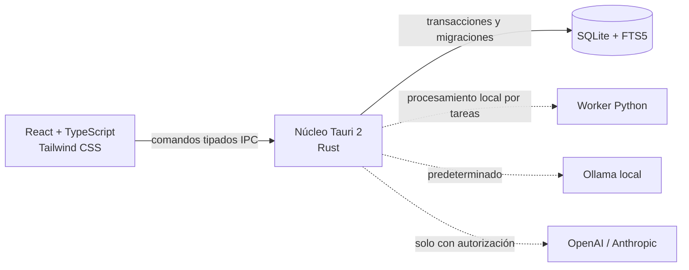

# Arquitectura de ResearchPilot

## Principios

1. **Local-first:** SQLite y los documentos viven en el equipo. Ollama será el proveedor de IA predeterminado.
2. **Consentimiento explícito:** seleccionar OpenAI o Anthropic no autoriza por sí solo a transferir documentos.
3. **Procedencia obligatoria:** el modelo separa el valor extraído, su evidencia, el actor y su estado de validación.
4. **Fronteras tipadas:** React invoca una API Tauri mínima; Rust valida y persiste.
5. **Migraciones reproducibles:** el esquema se versiona y cada instalación aplica transacciones atómicas.

## Componentes

### Interfaz

Vite compila una SPA React. `HashRouter` mantiene navegación estable dentro del WebView de Tauri. `useResearchPilot` conserva el snapshot de la aplicación y solo conoce tres operaciones en esta fase: inicializar, crear una revisión y guardar configuración. El tema claro/oscuro/sistema se aplica en tiempo real y un catálogo i18n tipado proporciona la base español–inglés.

### Núcleo Rust

`src-tauri/src/db.rs` concentra conexiones, migraciones, validación y transacciones. Los comandos Tauri reciben DTOs serializables y no aceptan SQL ni rutas arbitrarias desde la interfaz.

SQLite se abre con claves foráneas activas, WAL y tiempo de espera ante bloqueos. La primera migración crea FTS5 para metadatos y relaciones para todos los módulos metodológicos.

### Worker Python

El paquete `researchpilot-worker` es deliberadamente mínimo en esta fase. Su contrato inicial es un comando `health` JSON. Extracción de PDF, GROBID y procesamiento científico se incorporarán como tareas aisladas en fases posteriores.

## Seguridad y privacidad

- `local_only=true` y `allow_external_processing=false` son los valores iniciales.
- Rust rechaza estados contradictorios que habiliten procesamiento externo mientras está activo el modo local.
- No se almacenan claves API en SQLite. La integración futura deberá usar el llavero del sistema (Keychain en macOS).
- La CSP de Tauri permite recursos propios e IPC, no contenido web arbitrario.
- `ai_runs` preserva proveedor, modelo, operación y hashes; `audit_events` registra cambios de entidades.

## Evolución prevista

La biblioteca documental, PDF.js, GROBID, embeddings, RAG, PRISMA e importadores/exportadores se construirán encima de las entidades actuales. Las migraciones nuevas son incrementales; la migración 2 demuestra actualización sin borrar datos. Los modelos de Ollama se descubrirán en ejecución y no se fija un nombre permanente.
