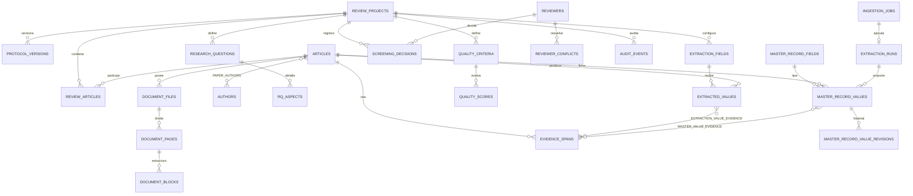

# Modelo de datos inicial

## ERD resumido

## Límites de agregado

- **Biblioteca global:** `articles`, autores, documentos, páginas, bloques, referencias, colecciones y etiquetas.
- **Revisión:** proyecto, versiones del protocolo, corpus, RQs, búsquedas, control, criterios, decisiones y evaluaciones.
- **Extracción verificable:** campos, ejecuciones, valores, evidencias y relaciones de apoyo/contradicción.
- **Operación:** trabajos de ingestión, proveedores/ejecuciones IA, índices de embeddings, exportaciones y auditoría.

## Integridad

- UUID de texto como identificadores estables para intercambio futuro.
- Claves foráneas y cascadas controladas.
- DOI y hashes únicos donde una colisión representa el mismo objeto global; versiones PDF se conservan en `document_files`.
- Eliminación lógica para objetos principales; las eliminaciones físicas internas se reservan para mantenimiento explícito.
- Los valores extraídos no son únicos por artículo/campo: pueden coexistir mediciones, configuraciones y contradicciones.
- La evidencia contiene documento, página, sección, cita y localizador JSON para bounding box cuando esté disponible.

## Ficha maestra (Fase 3)

- `master_record_fields` es el catálogo global (no depende de una revisión); `extraction_fields` sigue siendo el esquema por proyecto/RQ de la Fase 6.
- `master_record_values` admite varios valores por campo; `superseded_by_run_id` oculta propuestas no revisadas de ejecuciones anteriores sin borrarlas.
- `master_record_value_revisions` es inmutable: editar o restaurar crea una revisión nueva.
- `not_reported` exige origen humano o revisor (restricción `CHECK`); `not_found` lo usa solo el extractor.

## Recuperación y asistente (Fase 4)

- `document_chunks` (+ `document_chunks_fts`): fragmentos literales por página/sección con `spans_json` (cajas de los bloques de origen).
- `chunk_embeddings`: clave `(content_sha256, model)`; vectores f32 normalizados. Los embeddings sobreviven a la re-fragmentación.
- `assistant_conversations` / `assistant_messages`: las citas se guardan como copia (artículo, página, cita, caja), de modo que el historial no depende de que el fragmento siga existiendo.
- `ai_runs`: cada llamada a un modelo con versión de prompt, hashes, tokens, duración, intentos y estado.
- Las propuestas de IA usan `master_record_values` con `origin = 'ai'`; cada origen (reglas o IA) solo reemplaza sus propias propuestas no revisadas.
